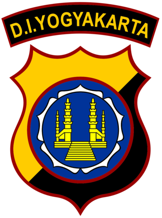

<div align="center">
  
  &nbsp;&nbsp;&nbsp;&nbsp;
  

  <h1>SIM-ASET BID TIK POLDA DIY</h1>
  <p><strong>Sistem Informasi Manajemen Aset TIK (BMN) &amp; Deteksi Dini Indikasi <em>Fraud</em> Berbasis <em>K-Means Clustering</em></strong></p>
  <p>
    <strong>Studi Kasus:</strong> Bidang Teknologi Informasi dan Komunikasi (BID TIK) Polda D.I. Yogyakarta<br />
    <strong>Penulis / Pengembang:</strong> Dimas Oktafian Prasetyo
  </p>
</div>

---

## Sebenarnya Ini Aplikasi Apa?

**SIM-ASET BID TIK POLDA DIY** adalah aplikasi web internal untuk mengelola siklus hidup **Barang Milik Negara (BMN)** perangkat Teknologi Informasi dan Komunikasi (seperti server, router, switch, firewall, radio HT, dan komputer operasional) sekaligus melakukan **audit forensik dan deteksi dini indikasi kecurangan (*fraud*)** secara otomatis.

Secara sederhana, aplikasi ini menjawab 3 kebutuhan utama di BID TIK Polda DIY:
1. **Tertib Administrasi BMN & Depresiasi:** Mencatat aset unik per `Kode BMN + NUP`, menghitung penyusutan nilai buku otomatis dengan metode garis lurus sesuai **PMK No. 181/PMK.06/2016**, serta mendokumentasikan Berita Acara Serah Terima (**BAST**) peminjaman dan mutasi antar Satker/Personel.
2. **Kontrol Pemeliharaan & Uji Kelayakan (QC):** Mengawal tiket kerusakan, penerbitan **SPK Vendor**, uji kelayakan teknis (QC), dan akumulasi biaya perbaikan agar transparan dan sesuai histori.
3. **Deteksi Dini Anomali / *Fraud* dengan *K-Means Clustering* (`K=3`):** Menggabungkan 3 variabel perilaku aset — **X1 (Frekuensi Servis)**, **X2 (Rasio Biaya Servis terhadap Nilai Buku)**, dan **X3 (Durasi Sirkulasi/Pinjam)** — yang dinormalisasi ke skala `[0, 1]` (*Min-Max Normalization*), lalu dikelompokkan oleh engine Python `scikit-learn` ke dalam 3 klaster risiko: **Normal**, **Waspada**, dan **Anomali / Indikasi Fraud**.

---

## Fitur Utama

- **Dashboard Eksekutif BMN:** Ringkasan KPI aset, sebaran klaster K-Means, kurva Elbow (`K=1..8`), tren biaya servis vs depresiasi, proyeksi nilai buku 12 bulan (`±10%`), bubble chart nilai aset vs biaya servis, dan daftar *Early Warning* terbaru.
- **Master Data BMN & Aset TIK:** Pengelolaan Satker, Personel (NRP), Kategori Aset, Lokasi Ruangan (DIR), Vendor Rekanan, serta inventaris perangkat TIK dengan kalkulasi nilai buku otomatis.
- **Sirkulasi & BAST Digital:** Pengajuan peminjaman/mutasi dengan dropdown pencarian aset & personel langsung dari database, validasi ketersediaan unit (`Tersedia` / `Dipinjam`), penomoran `BAST/TIK/...` otomatis, serta pemantauan ketepatan waktu pengembalian.
- **Pemeliharaan, SPK & Uji QC:** Pencatatan tiket servis (`TIK-...`) dan `SPK/TIK/...` otomatis, kontrol uji QC, dan verifikasi biaya servis.
- **Rekonsiliasi BMN:** Pencatatan *stock opname* semesteran dan penerbitan Berita Acara Rekonsiliasi (`BAR/TIK/...`).
- **Engine Analitik K-Means & Early Warning Audit:** Eksekusi klasterisasi `K=3`, evaluasi *Silhouette Coefficient* & *Elbow SSE*, dekomposisi kontribusi pemicu risiko (`X1`, `X2`, `X3 %`), interpretasi hasil analisis, dan tindak lanjut investigasi auditor.
- **6 Laporan PDF Resmi:** Cetak laporan berkop resmi **BID TIK Polda D.I. Yogyakarta** (Inventaris & Depresiasi, Sirkulasi & Mutasi, Pemeliharaan & QC, Audit K-Means, Berita Acara Rekonsiliasi, dan Data Master).
- **Keamanan & Tata Kelola:** Autentikasi JWT + Bcrypt, manajemen user, matriks **RBAC 5 Peran** yang dapat diatur langsung melalui *switch* hak akses, serta **Audit Trail Sistem** (`log_aktivitas_sistem`).

---

## Arsitektur & Teknologi

- **Frontend:** React 18 + Vite + Ant Design 5 + Recharts + Redux Toolkit (`frontend/`)
- **Backend API:** Node.js + Express.js (`backend/`)
- **ML Engine:** Python (`scikit-learn`, `pandas`, `numpy`) untuk *Min-Max Normalization* & *K-Means Clustering* (`backend/python_engine/kmeans_fraud.py`)
- **Database:** MySQL 21 Tabel Relasional 3NF via XAMPP (`127.0.0.1:3306`, skema di `backend/src/database/schema_21_tables.sql`)
- **Dokumentasi Teknis:** [doc/PRD_SISTEM_ASET_KMEANS_BID_TIK.md](doc/PRD_SISTEM_ASET_KMEANS_BID_TIK.md) & [doc/README_BACKEND_DAN_ALGORITMA.md](doc/README_BACKEND_DAN_ALGORITMA.md)

---

## Cara Menjalankan (Development)

### 1. Backend & Database MySQL
```powershell
cd backend
npm install
pip install -r python_engine/requirements.txt
# Salin backend/.env.example menjadi backend/.env dan sesuaikan konfigurasi MySQL XAMPP
npm run dev
```
Server API berjalan di `http://localhost:8888` (skema 21 tabel & data awal otomatis diinisialisasi saat startup).

### 2. Frontend
```powershell
cd frontend
npm install
npm run dev
```
Aplikasi web berjalan di `http://localhost:3000`.

### Akun Login Default
- **Email:** `admin@admin.com`
- **Password:** `admin123`
